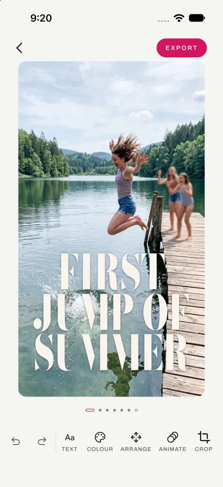
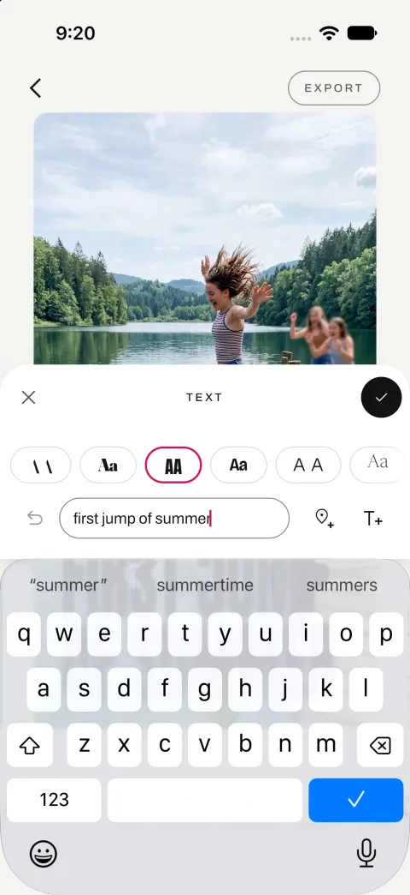

Veduta is a small idea. You pick a photograph, and a few moments later you get a row of designs: your words set into the picture like a magazine cover, clear of faces, in a colour you can actually read. You swipe between them, drag the text where you want it, and export a still or a short clip.

<figure><figcaption>Open a photo: every tool is there straight away</figcaption></figure><figure><figcaption>Write a line: the first design</figcaption></figure><figure><figcaption>Swipe: the same words, another design</figcaption></figure><figure><figcaption>Swipe again: a third design</figcaption></figure><figure><figcaption>The text panel, with a row of styles to pick from</figcaption></figure><figure><figcaption>Add the location: a pin and the name, its own text</figcaption></figure>

I did not write the app's code by hand. I wrote down what the app should do, and a team of AI agents wrote the code. Those agents run in the cloud, on Claude. The app itself uses small AI models that run on the phone, so your photographs never leave it.

This post covers both: how the agents built the app, and what I learnt putting AI models inside it. Most of it is about what went wrong the first time.

## What I built: an app, an engine, and a builder

There are three pieces of software here.

- **Veduta** is the app, for Android and iOS, written once in Kotlin Multiplatform.
- **Vinyas** is the engine inside the app. It looks at the photograph, decides where the words can go, sets them in a typeface, checks they are readable, and draws the result.
- **ASTRAMAN** is the builder. It takes a written description of an app and turns it into a working app, one small step at a time, with a review after every step.

## How ASTRAMAN turns a written description into an app

ASTRAMAN is a small team of AI agents. Each one is Claude with its own instructions and its own job.

| Agent | What it does | Model |
|---|---|---|
| Vishwakarma | Reads the description and plans the build, step by step | Opus, the strongest |
| Karma | Writes the code for one step and saves it | Sonnet, the fastest |
| Fixer | Fixes only what the reviewer found | Sonnet |
| Vivek | Checks every step: does it build, do the tests pass, does it do what the description says | Sonnet |
| Drishti | Reads a finished build and suggests how the agents could do better | Sonnet |

Four decisions made the biggest difference.

**Code checks the description, not an agent.** The description is a set of plain files: numbered requirements, one file per screen with "when I do this, that happens" rules, colours and sizes. A script checks them before anything is built, and writes each step's own checklist of what "done" means. No agent ever has to guess.

**Each skill is written down once.** About fifty short guides, called skills, cover things like navigation, the database, dark mode and accessibility. Library versions live only there. The plan never copies a version number, because a copied number goes stale the day the guide is updated.

**Scripts do the repeatable work.** Some steps produce the same files every time, like the empty project or the custom style checks. A script writes those in seconds, for free. The AI only steps in if the script fails.

**The strongest model plans, a fast one writes code.** Halfway through the Veduta build I moved the code writer to a newer, faster Sonnet. Its typical time per step halved, from about 13 minutes to about 6.

## Building Veduta: 82 steps, all reviewed, and still broken on the phone

Veduta's plan had 82 steps, from an empty project to ready for the store. It used the real engine from the first step, with no fake data behind the screens.

Every step passed review. Then I installed the app on a phone and used it.

Within minutes I found a button that froze, settings from one photograph showing up on the next, a drag that lagged behind my finger, and a move that did not stick. The build log puts it plainly: *the review checked the code against the description; nobody used the app.*

That changed how I think about automated builds. A passing review proves the code matches the words. It does not prove the app works. Testing on a real phone is now part of every build.

## What the build cost in time, tokens and money

ASTRAMAN records every agent run: how long it took, how long it waited for Gradle (the tool that compiles an Android app), how much text the model read and wrote, and what that would cost on the API. The model counts text in tokens, roughly three quarters of a word each. Here are the numbers for three apps it built.

<figure class="chart"><svg viewBox="0 0 640 202" width="100%" role="img" aria-label="Hours the agents worked on each app: thinking and writing code (dark), waiting for Gradle (light)" style="max-width:640px;font-family:var(--mono,ui-monospace,monospace);font-size:13px"><text x="140" y="44" text-anchor="end" fill="var(--ink,#0E1A20)">Sudoku3</text><text x="140" y="59" text-anchor="end" fill="var(--ink-3,#5A6B73)" font-size="11">46 steps</text><rect x="150.0" y="30" width="260.0" height="24" fill="var(--b-800,#0B5C78)"/><rect x="410.0" y="30" width="58.6" height="24" fill="var(--b-500,#13B0E5)"/><text x="476.6" y="47" fill="var(--ink,#0E1A20)">22.3h</text><text x="140" y="88" text-anchor="end" fill="var(--ink,#0E1A20)">sudoku4</text><text x="140" y="103" text-anchor="end" fill="var(--ink-3,#5A6B73)" font-size="11">50 steps</text><rect x="150.0" y="74" width="192.9" height="24" fill="var(--b-800,#0B5C78)"/><rect x="342.9" y="74" width="27.1" height="24" fill="var(--b-500,#13B0E5)"/><text x="378.0" y="91" fill="var(--ink,#0E1A20)">15.4h</text><text x="140" y="132" text-anchor="end" fill="var(--ink,#0E1A20)">Veduta</text><text x="140" y="147" text-anchor="end" fill="var(--ink-3,#5A6B73)" font-size="11">81 steps</text><rect x="150.0" y="118" width="332.9" height="24" fill="var(--b-800,#0B5C78)"/><rect x="482.9" y="118" width="62.9" height="24" fill="var(--b-500,#13B0E5)"/><text x="553.7" y="135" fill="var(--ink,#0E1A20)">27.7h</text><rect x="150" y="178" width="12" height="12" fill="var(--b-800,#0B5C78)"/><text x="168" y="188" fill="var(--ink-3,#5A6B73)" font-size="12">thinking and writing</text><rect x="350" y="178" width="12" height="12" fill="var(--b-500,#13B0E5)"/><text x="368" y="188" fill="var(--ink-3,#5A6B73)" font-size="12">Gradle</text></svg><figcaption>Hours the agents worked on each app: thinking and writing code (dark), waiting for Gradle (light)</figcaption></figure>

<figure class="chart"><svg viewBox="0 0 640 246" width="100%" role="img" aria-label="What Veduta's build cost, by agent, at API prices" style="max-width:640px;font-family:var(--mono,ui-monospace,monospace);font-size:13px"><text x="140" y="44" text-anchor="end" fill="var(--ink,#0E1A20)">Code writer</text><text x="140" y="59" text-anchor="end" fill="var(--ink-3,#5A6B73)" font-size="11">Karma</text><rect x="150.0" y="30" width="374.7" height="24" fill="var(--b-800,#0B5C78)"/><text x="532.7" y="47" fill="var(--ink,#0E1A20)">US$281</text><text x="140" y="88" text-anchor="end" fill="var(--ink,#0E1A20)">Reviewer</text><text x="140" y="103" text-anchor="end" fill="var(--ink-3,#5A6B73)" font-size="11">Vivek</text><rect x="150.0" y="74" width="320.0" height="24" fill="var(--b-800,#0B5C78)"/><text x="478.0" y="91" fill="var(--ink,#0E1A20)">US$240</text><text x="140" y="132" text-anchor="end" fill="var(--ink,#0E1A20)">Fixer</text><text x="140" y="147" text-anchor="end" fill="var(--ink-3,#5A6B73)" font-size="11">retries</text><rect x="150.0" y="118" width="20.0" height="24" fill="var(--b-800,#0B5C78)"/><text x="178.0" y="135" fill="var(--ink,#0E1A20)">US$15</text><text x="140" y="176" text-anchor="end" fill="var(--ink,#0E1A20)">Planner</text><text x="140" y="191" text-anchor="end" fill="var(--ink-3,#5A6B73)" font-size="11">Vishwakarma</text><rect x="150.0" y="162" width="6.7" height="24" fill="var(--b-800,#0B5C78)"/><text x="164.7" y="179" fill="var(--ink,#0E1A20)">US$5</text><rect x="150" y="222" width="12" height="12" fill="var(--b-800,#0B5C78)"/><text x="168" y="232" fill="var(--ink-3,#5A6B73)" font-size="12">US$ at API prices</text></svg><figcaption>What Veduta's build cost, by agent, at API prices</figcaption></figure>

<figure class="chart"><svg viewBox="0 0 640 310" width="100%" role="img" aria-label="The code writer before and after moving to a faster model (a typical step)" style="max-width:640px;font-family:var(--mono,ui-monospace,monospace);font-size:13px"><text x="140" y="44" text-anchor="end" fill="var(--ink,#0E1A20)">Writer, minutes</text><rect x="150" y="24" width="330.0" height="22" fill="var(--ink-3,#5A6B73)"/><text x="488.0" y="40" fill="var(--ink,#0E1A20)">12.8 min <tspan fill="var(--ink-3,#5A6B73)" font-size="11">before</tspan></text><rect x="150" y="52" width="157.3" height="22" fill="var(--b-500,#13B0E5)"/><text x="315.3" y="68" fill="var(--ink,#0E1A20)">6.1 min <tspan fill="var(--ink-3,#5A6B73)" font-size="11">after</tspan></text><text x="140" y="114" text-anchor="end" fill="var(--ink,#0E1A20)">Writer, cost</text><rect x="150" y="94" width="330.0" height="22" fill="var(--ink-3,#5A6B73)"/><text x="488.0" y="110" fill="var(--ink,#0E1A20)">$4.29 <tspan fill="var(--ink-3,#5A6B73)" font-size="11">before</tspan></text><rect x="150" y="122" width="139.2" height="22" fill="var(--b-500,#13B0E5)"/><text x="297.2" y="138" fill="var(--ink,#0E1A20)">$1.81 <tspan fill="var(--ink-3,#5A6B73)" font-size="11">after</tspan></text><text x="140" y="184" text-anchor="end" fill="var(--ink,#0E1A20)">Whole step</text><rect x="150" y="164" width="330.0" height="22" fill="var(--ink-3,#5A6B73)"/><text x="488.0" y="180" fill="var(--ink,#0E1A20)">19.5 min <tspan fill="var(--ink-3,#5A6B73)" font-size="11">before</tspan></text><rect x="150" y="192" width="238.6" height="22" fill="var(--b-500,#13B0E5)"/><text x="396.6" y="208" fill="var(--ink,#0E1A20)">14.1 min <tspan fill="var(--ink-3,#5A6B73)" font-size="11">after</tspan></text><text x="140" y="254" text-anchor="end" fill="var(--ink,#0E1A20)">Whole step, cost</text><rect x="150" y="234" width="330.0" height="22" fill="var(--ink-3,#5A6B73)"/><text x="488.0" y="250" fill="var(--ink,#0E1A20)">$7.25 <tspan fill="var(--ink-3,#5A6B73)" font-size="11">before</tspan></text><rect x="150" y="262" width="214.8" height="22" fill="var(--b-500,#13B0E5)"/><text x="372.8" y="278" fill="var(--ink,#0E1A20)">$4.72 <tspan fill="var(--ink-3,#5A6B73)" font-size="11">after</tspan></text></svg><figcaption>The code writer before and after moving to a faster model (a typical step)</figcaption></figure>

| Veduta, 81 steps | |
|---|---|
| Time the agents worked | 27.7 hours, spread over five days with pauses for usage limits |
| Of that, waiting for Gradle | 4.4 hours (16%) |
| Text the models wrote | 7.6 million tokens |
| Text the models re-read from memory | 1.57 billion tokens |
| New text the models read | about 17 thousand tokens |
| Cost at API prices | about US$541, or about US$6.70 a step |

A few things stand out.

- **Checking costs almost as much as building.** The reviewer cost US$240 and the code writer US$281. That is the price of every step being checked before the next one starts, and it is worth it.
- **The time goes to the AI, not the compiler.** Waiting for Gradle was only 16% of the time. Every speed-up that mattered came from the AI side: a faster model, less to read, scripts instead of prompts.
- **The agents mostly re-read what they have seen before.** For every new token, about ninety thousand came from the model's short-term memory (the cache): the skills, the description and the code from earlier steps. That is what keeps a long build affordable.
- **A faster model was the cheapest win.** Switching the code writer at step 30 halved its typical time per step and more than halved its cost.

The costs are what the same work would cost on the API. I ran these builds on a subscription.

## Why Veduta keeps every photo on the phone

Veduta's first rule: no photograph ever leaves the phone. There is no server, no account and no tracking. It works offline from the first launch. Its App Store privacy label will be "Data Not Collected".

So everything the app knows about a photograph comes from small AI models that run on the phone itself.

| What it finds | Android | iOS |
|---|---|---|
| Faces | BlazeFace | Apple's Vision framework |
| People | EfficientDet-Lite0 | Apple's Vision framework |
| The main subject | DeepLab | Apple's Vision framework |
| Light and dark areas | Plain code, no AI | Plain code, no AI |

The Android models are open source and come to about 8 MB together. iOS uses what Apple already ships with the phone.

The models only answer "where are the faces, where is the subject, which areas are light or dark". Everything after that, where the words go, how big they are, which colour reads best, is ordinary code. It takes well under a quarter of a second per design.

## Lesson 1: We removed the AI that wrote captions

The first version also had a language model on the phone: Apple's on-device model on iOS, with Google's Gemini Nano considered for Android. At first it wrote a caption for the photo. Then five captions to choose from. Then we asked it where the words should go and what colour they should be.

We tested that last idea on five photographs.

- **Where to put the words:** right once in five. It put them right where a person was holding a piece of coral, after being told never to cover the subject.
- **What colour:** it said "dark" for all five, including one that needed light words on dark leaves.

A language model cannot measure how readable a colour is on the real pixels. Ordinary code can. So the rule became: *the AI says what it sees, the code decides.*

Then the captions got slower and no more useful. Looking at the photo took up to 1.4 seconds, but writing five captions could take another 18 seconds. Worse, Apple's built-in safety filter refused an ordinary photo of a man lifting a dumbbell in a gym ("May contain sensitive content"), so the app spun for most of a minute and showed nothing.

A reviewer put it bluntly: the designs were great, the captions were the worst part. So we removed the language model. A full set of designs now appears in under two seconds, and people write their own words, which they wanted to do anyway.

**Use AI to describe what is in the picture. Use ordinary code for anything you can measure.**

## Lesson 2: Our face tests passed because they expected nothing

Some of our tests compare the engine's answer with a saved copy of the right answer for each photo. On iOS, those saved answers had been recorded from the face detector itself.

The problem: when a face is small, under about 3% of the photo's width, Apple's detector misses it if you hand it the whole photo at once. On two group photos it found none of the 14 faces. The saved answer said "no faces", the detector said "no faces", and the test passed.

So I had a person mark every face by hand: 128 of them. Against that, the detector found 38, and only 3 of the 75 small ones. The fix was to cut the photo into overlapping squares, look for faces in each, and merge the results. Both group photos went to 7 out of 7.

**Check a detector against answers a person has checked, not against what it said last time.**

## Lesson 3: We compared ML Kit with BlazeFace, and kept both

On Android there are two common ways to find faces: Google's ML Kit, and a small open model called BlazeFace. We ran both on the same 39 photos on a real phone.

| Face detector | Faces found |
|---|---|
| ML Kit | 84% (32 of 38) |
| BlazeFace, photo cut into squares | 92% (35 of 38) |
| BlazeFace, smaller overlapping squares | 97% (37 of 38) |

BlazeFace won. The smaller squares cost about 25% more time, which was worth it.

Finding the main subject was a harder call. ML Kit drew better outlines, but on a real phone it crashed the whole app, in a way the app cannot catch and recover from. The engine's first rule is that it never crashes the app, so the open DeepLab model is the default and ML Kit is off unless you switch it on.

I kept both options in the code. A future update to either model could change the answer, and switching back is one line.

## Lesson 4: The slow part was our own code, not the AI models

Reading a photo on Android took about 3 seconds. Now it takes about 1, and a large 12-megapixel photo went from 5.6 seconds to 1.4. The results are exactly the same as before.

None of the speed-up came from the AI models.

- The three models now look at the photo at the same time, instead of one after another.
- The squares for the face detector are cut before it asks for them.
- The code that shrinks the photo before the models see it, plain Kotlin, was **more than half** of the total time. Rewriting it was the biggest win.
- Each model starts warming up when the app opens, so the first photo after launch dropped from 1.4 seconds to 0.9.

ASTRAMAN taught the same thing. Before trying to speed up builds, I measured where the time went: about 81% was the AI thinking and only 19% was compiling. Speeding up the compiler could never have helped much.

One more rule from the app: **never make the screen wait for a model.** Veduta shows your photo straight away and the designs fade in underneath as they are ready.

## Lesson 5: Moving a text can make it invisible

We added tap to write: tap an empty spot on the photo and your words go there. Every test passed. On the iPhone simulator, I tapped, typed "here", and nothing appeared.

The words were there. The engine had first placed them in its usual spot, picked a colour that read well *there*, and then moved them to my tap. The colour came along. Near-black words on a dark patch of jungle are still words. You just cannot see them.

The tests checked that the text existed and sat where I tapped. None of them looked at the photo underneath. The fix was to tell the engine where the words go from the start, so it picks the colour for the spot they will actually sit on.

**A colour that reads well in one place can vanish in another. Move the words, check the colour again.**

## What I tried that did not work

- **Running several agents at once.** I tried building several steps in parallel. It was no faster, and their changes clashed when merged. A faster model for each step did far more.
- **Telling the agents in words.** When an agent made the same mistake twice, I first added a sentence to its instructions. The mistake came back. What worked was a check in code that fails the build. When "keep each commit under 300 lines" became a check instead of a sentence, oversized commits went from about 30% to under 1%.
- **Taking an agent's word for it.** An agent once said a failing test was "already broken before my change". It was not. Now I check claims like that myself.

## How we work now: build in small pieces, test everything once

- Agents work on small, separate pieces at the same time, and only run the quick checks: style checks, does it compile for both phones, and the tests for what they touched. A few minutes each.
- When the pieces are merged, one full run checks everything: every test, the iPhone simulator tests, the screenshot tests, and the full iOS build.
- Only when that passes does anything get published, all at once.

Since the 82 steps finished, this way of working has added layouts for foldables and iPads, in-app purchases, several texts on one design, and a row of text styles. Each style shows as a small "Aa" drawn by the engine itself, so what you tap is exactly what you get.

Most of these changes came from using the app, not from the description. The location used to sit inside the headline. Now it is its own text with a pin, which you can move or delete like any other. And the app no longer makes you write a line first. Every tool is there from the start, and you can tap anywhere on the photo to write.

## What I still do myself

ASTRAMAN builds the app. It does not decide what the app should be. These stay with me:

- writing the description and working through the design rounds;
- product calls, like removing the captions or keeping phones in portrait;
- testing on a real phone, with sample photos only;
- everything in the app stores: products, prices, signing and legal text.

I keep a note of every time I had to step in during a build. It is the most useful file in the project. Each entry is either a call only a person should make, or a gap in ASTRAMAN that I should fix in code so I never have to step in for it again.

## What sharing this on LinkedIn taught me

I have been posting about this work as it happens. The posts that people responded to were never the diagrams. They were a real moment, like a phone call that wiped my progress in a Sudoku game the agents built, or a familiar idea in a new place: *I run unit tests on my skills. They are called evals.* A plain screenshot of a real dashboard did better than any graphic I designed. Real evidence beats polish, which is also the lesson of the whole build.

## If you want to build apps this way

- Write down what the app should do as structured files, and check them with code before any agent reads them.
- Keep versions and how-tos in one place, never copied into plans.
- Let scripts do anything that comes out the same every time.
- Plan with the strongest model, write code with a fast one.
- When a mistake repeats, add a check, not a sentence.
- Review every step, and still use the app on a real phone before you trust the review.
- Inside the app, let AI describe the picture and let ordinary code make the decisions.

Veduta is not in the stores yet. What is left needs a person: store listings, signing and the legal pages. When it ships, I will link it here.
