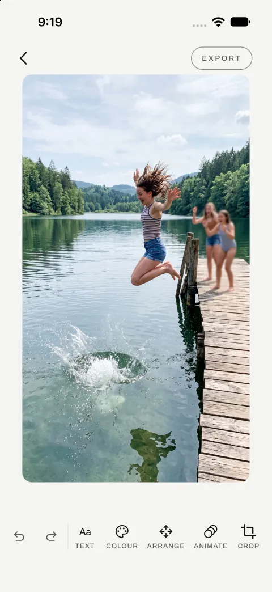
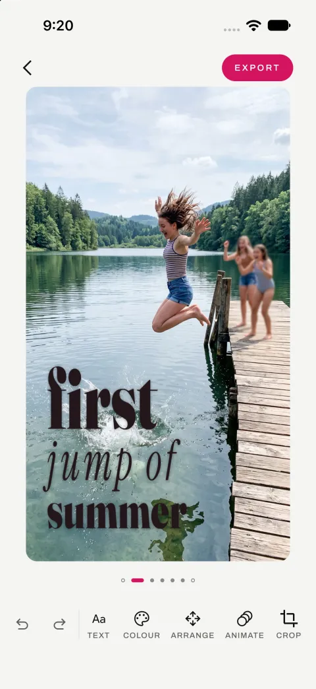
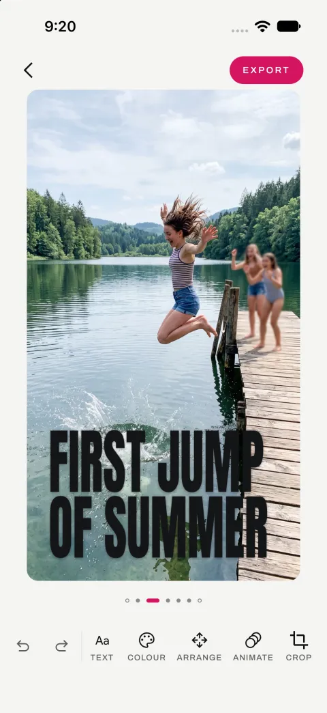
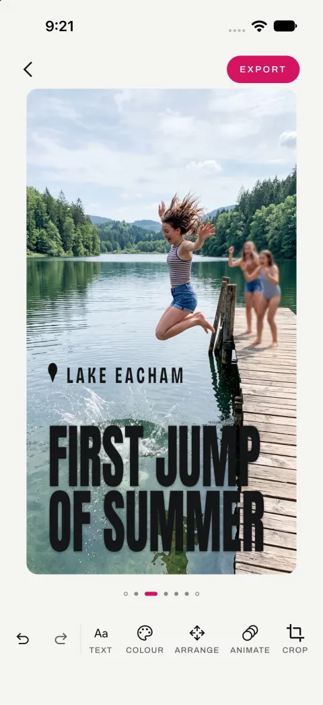
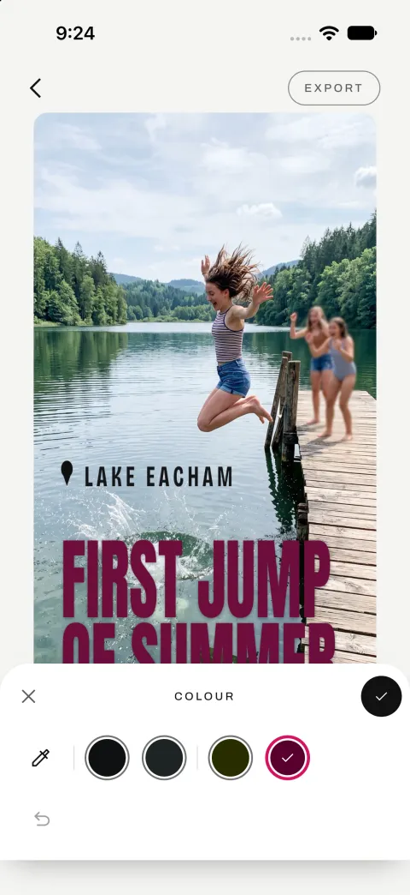
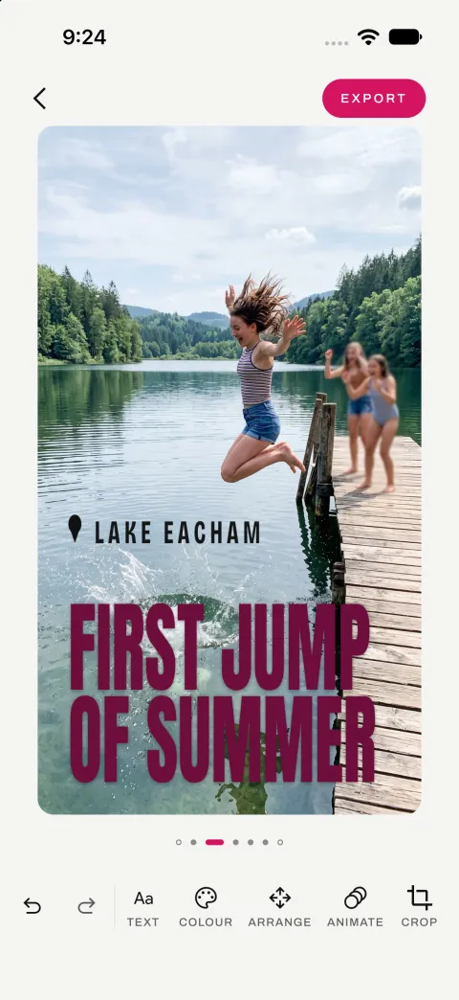
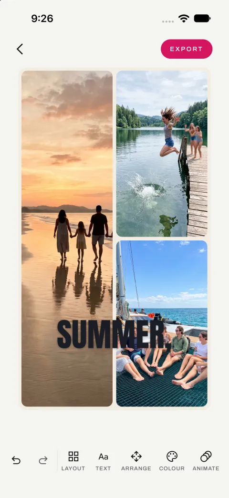

A team of AI agents built my app in 82 steps. Every step passed review. Within minutes of using it on a phone, I found four bugs. This post is about that gap, and about what I learnt putting small AI models inside the app itself.

Veduta is a small idea. You pick a photograph, and a few moments later you get a row of designs: your words set into the picture like a magazine cover, clear of faces, in a colour you can actually read. You swipe between them, drag the text where you want it, and export a still or a short clip.

<figure><figcaption>Open a photo: every tool is there straight away</figcaption></figure><figure><figcaption>Write a line: one of the designs</figcaption></figure><figure><figcaption>Swipe: the same words, another design</figcaption></figure><figure><figcaption>Add the location: a pin and the name, its own text</figcaption></figure><figure><figcaption>Pick a colour: the choices come from the photo itself</figcaption></figure><figure><figcaption>The same design in plum</figcaption></figure><figure><figcaption>Three photos in one collage, with a line across them</figcaption></figure>

I did not type the app's code. I wrote down what it should do, read the plans and the reviews, and tested every build on a phone. A team of AI agents wrote the code. Those agents run in the cloud, on Claude. The app itself uses small AI models that run on the phone, so your photographs never leave it.

Below, "we" means me and the agents. The photos in the screenshots are AI-generated samples; no real people appear in them.

## Three pieces: the app, its design engine, and the AI that built them

There are three pieces of software in this story.

- **Veduta** is the app, for Android and iOS, written once in Kotlin Multiplatform.
- **Vinyas** is the engine inside the app. It looks at the photograph, decides where the words can go, sets them in a typeface, checks they are readable, and draws the result.
- **ASTRAMAN** is the builder. It takes a written description of an app and turns it into a working app, one small step at a time, with a review after every step.

<figure class="chart"><svg viewBox="0 0 640 236" width="100%" role="img" aria-label="ASTRAMAN builds Veduta. Veduta contains the Vinyas engine, which asks small AI models on the phone." style="max-width:640px" font-family="var(--mono,ui-monospace,monospace)" font-size="12"><rect x="8" y="20" width="190" height="78" fill="var(--paper,#FFFFFF)" stroke="var(--ink,#0E1A20)" stroke-width="2"/><text x="20" y="44" fill="var(--ink,#0E1A20)" font-size="15" font-weight="700">ASTRAMAN</text><text x="20" y="64" fill="var(--ink,#0E1A20)" font-size="11">AI agents, in the cloud</text><text x="20" y="80" fill="var(--ink,#0E1A20)" font-size="11">write the app's code</text><line x1="198" y1="59" x2="250" y2="59" stroke="var(--ink,#0E1A20)" stroke-width="2"/><path d="M250 53 L260 59 L250 65 Z" fill="var(--ink,#0E1A20)"/><text x="206" y="50" fill="var(--ink-3,#5A6B73)" font-size="10">builds</text><rect x="262" y="8" width="370" height="220" fill="none" stroke="var(--ink,#0E1A20)" stroke-width="2"/><text x="276" y="32" fill="var(--ink,#0E1A20)" font-size="15" font-weight="700">Veduta</text><text x="276" y="50" fill="var(--ink-3,#5A6B73)" font-size="11">the app on your phone, Android and iOS</text><rect x="282" y="66" width="330" height="70" fill="var(--b-500,#13B0E5)" stroke="var(--ink,#0E1A20)" stroke-width="2"/><text x="294" y="90" fill="var(--ink,#0E1A20)" font-size="15" font-weight="700">Vinyas</text><text x="294" y="110" fill="var(--ink,#0E1A20)" font-size="11">the design engine inside the app:</text><text x="294" y="126" fill="var(--ink,#0E1A20)" font-size="11">where the words go, typeface, colour, drawing</text><line x1="447" y1="136" x2="447" y2="156" stroke="var(--ink,#0E1A20)" stroke-width="2"/><path d="M441 156 L447 166 L453 156 Z" fill="var(--ink,#0E1A20)"/><text x="455" y="152" fill="var(--ink-3,#5A6B73)" font-size="10">asks</text><rect x="282" y="168" width="330" height="50" fill="var(--b-800,#0B5C78)" stroke="var(--ink,#0E1A20)" stroke-width="2"/><text x="294" y="192" fill="#FFFFFF" font-size="15" font-weight="700">On-device AI models</text><text x="294" y="212" fill="#FFFFFF" font-size="11">find faces, people and the subject</text><text x="294" y="228" fill="#FFFFFF" font-size="11"></text></svg><figcaption>Who does what: the agents build the app; the app does its own seeing, on the phone.</figcaption></figure>

## How ASTRAMAN turns a written description into an app

ASTRAMAN is a small team of AI agents. Each one is Claude with its own instructions and its own job.

| Agent | What it does | Model |
|---|---|---|
| Vishwakarma | Reads the description and plans the build, step by step | Opus, better at planning |
| Karma | Writes the code for one step and saves it | Sonnet, faster and cheaper |
| Fixer | Fixes only what the reviewer found | Sonnet |
| Vivek | Checks every step: does it build, do the tests pass, does it do what the description says | Sonnet |
| Drishti | Reads a finished build and suggests how the agents could do better | Sonnet |

Four decisions made the biggest difference.

**Code checks the description, not an agent.** The description is a set of plain files: numbered requirements, one file per screen with "when I do this, that happens" rules, colours and sizes. A script checks them before anything is built, and writes each step's own checklist of what "done" means. No agent ever has to guess.

**Each skill is written down once.** About forty short guides, called skills, cover things like navigation, the database, dark mode and accessibility. Library versions live only there. The plan never copies a version number, because a copied number goes stale the day the guide is updated.

**Scripts do the repeatable work.** Some steps produce the same files every time, like the empty project or the custom style checks. A script writes those in seconds, for free. The AI only steps in if the script fails.

**The strongest model plans, a fast one writes code.** Halfway through the Veduta build I moved the code writer to a newer, faster Sonnet. The code writer's typical (median) time per step halved, from about 13 minutes to about 6.

## Building Veduta: 82 steps, all reviewed, and still broken on the phone

Veduta's plan had 82 steps, from an empty project to ready for the store. (The cost log below has 81: one step ran before logging was switched on.) It used the real engine from the first step, with no fake data behind the screens.

Every step passed review. Then I installed the app on a phone and used it.

Within minutes I found a button that froze, settings from one photograph showing up on the next, a drag that lagged behind my finger, and a move that did not stick. The build log puts it plainly: *the review checked the code against the description; nobody used the app.*

That changed how I think about automated builds. A passing review proves the code matches the words. It does not prove the app works. Testing on a real phone is now part of every build. It keeps paying off: just this week, every test passed for a new tap-to-write feature, and on the phone the words came out near-black on a dark patch of jungle, there but invisible. Nobody had looked at the screen.

## What the build cost in time, tokens and money

ASTRAMAN records every agent run: how long it took, how long it waited for Gradle (the tool that compiles an Android app), how much text the model read and wrote, and what that would cost on the API. The model counts text in tokens, roughly three quarters of a word each. Here are the numbers for Veduta and for two earlier test builds of a Sudoku app.

<figure class="chart"><svg viewBox="0 0 300 260" width="100%" role="img" aria-label="Hours the agents worked on each app" style="max-width:300px" font-family="var(--mono,ui-monospace,monospace)" font-size="12"><line x1="8" y1="208" x2="292" y2="208" stroke="var(--rule,#D6E0E5)"/><rect x="32.3" y="117.0" width="46.0" height="91.0" fill="var(--b-800,#0B5C78)"/><rect x="32.3" y="96.5" width="46.0" height="20.5" fill="var(--b-500,#13B0E5)"/><text x="55.3" y="90.5" text-anchor="middle" fill="var(--ink,#0E1A20)" font-size="12">22.3h</text><text x="55.3" y="225" text-anchor="middle" fill="var(--ink,#0E1A20)" font-size="11">Sudoku 3</text><text x="55.3" y="239" text-anchor="middle" fill="var(--ink-3,#5A6B73)" font-size="10">46 steps</text><rect x="127.0" y="140.5" width="46.0" height="67.5" fill="var(--b-800,#0B5C78)"/><rect x="127.0" y="131.0" width="46.0" height="9.5" fill="var(--b-500,#13B0E5)"/><text x="150.0" y="125.0" text-anchor="middle" fill="var(--ink,#0E1A20)" font-size="12">15.4h</text><text x="150.0" y="225" text-anchor="middle" fill="var(--ink,#0E1A20)" font-size="11">Sudoku 4</text><text x="150.0" y="239" text-anchor="middle" fill="var(--ink-3,#5A6B73)" font-size="10">50 steps</text><rect x="221.7" y="91.5" width="46.0" height="116.5" fill="var(--b-800,#0B5C78)"/><rect x="221.7" y="69.5" width="46.0" height="22.0" fill="var(--b-500,#13B0E5)"/><text x="244.7" y="63.5" text-anchor="middle" fill="var(--ink,#0E1A20)" font-size="12">27.7h</text><text x="244.7" y="225" text-anchor="middle" fill="var(--ink,#0E1A20)" font-size="11">Veduta</text><text x="244.7" y="239" text-anchor="middle" fill="var(--ink-3,#5A6B73)" font-size="10">81 steps</text><rect x="8" y="6" width="10" height="10" fill="var(--b-800,#0B5C78)"/><text x="22" y="15" fill="var(--ink-3,#5A6B73)" font-size="10">thinking, writing</text><rect x="144.8" y="6" width="10" height="10" fill="var(--b-500,#13B0E5)"/><text x="158.8" y="15" fill="var(--ink-3,#5A6B73)" font-size="10">waiting for Gradle</text></svg><figcaption>Hours the agents worked on each app</figcaption></figure><figure class="chart"><svg viewBox="0 0 300 260" width="100%" role="img" aria-label="What Veduta's build cost, by agent (US$, at API prices)" style="max-width:300px" font-family="var(--mono,ui-monospace,monospace)" font-size="12"><line x1="8" y1="208" x2="292" y2="208" stroke="var(--rule,#D6E0E5)"/><rect x="23.6" y="67.5" width="39.8" height="140.5" fill="var(--b-800,#0B5C78)"/><text x="43.5" y="61.5" text-anchor="middle" fill="var(--ink,#0E1A20)" font-size="12">$281</text><text x="43.5" y="225" text-anchor="middle" fill="var(--ink,#0E1A20)" font-size="11">Writer</text><text x="43.5" y="239" text-anchor="middle" fill="var(--ink-3,#5A6B73)" font-size="10">Karma</text><rect x="94.6" y="88.0" width="39.8" height="120.0" fill="var(--b-800,#0B5C78)"/><text x="114.5" y="82.0" text-anchor="middle" fill="var(--ink,#0E1A20)" font-size="12">$240</text><text x="114.5" y="225" text-anchor="middle" fill="var(--ink,#0E1A20)" font-size="11">Reviewer</text><text x="114.5" y="239" text-anchor="middle" fill="var(--ink-3,#5A6B73)" font-size="10">Vivek</text><rect x="165.6" y="200.5" width="39.8" height="7.5" fill="var(--b-800,#0B5C78)"/><text x="185.5" y="194.5" text-anchor="middle" fill="var(--ink,#0E1A20)" font-size="12">$15</text><text x="185.5" y="225" text-anchor="middle" fill="var(--ink,#0E1A20)" font-size="11">Fixer</text><rect x="236.6" y="205.5" width="39.8" height="2.5" fill="var(--b-800,#0B5C78)"/><text x="256.5" y="199.5" text-anchor="middle" fill="var(--ink,#0E1A20)" font-size="12">$5</text><text x="256.5" y="225" text-anchor="middle" fill="var(--ink,#0E1A20)" font-size="11">Planner</text></svg><figcaption>What Veduta's build cost, by agent (US$, at API prices)</figcaption></figure>

<figure class="chart"><svg viewBox="0 0 300 250" width="100%" role="img" aria-label="Minutes per step, before and after a faster model" style="max-width:300px" font-family="var(--mono,ui-monospace,monospace)" font-size="12"><line x1="8" y1="210" x2="292" y2="210" stroke="var(--rule,#D6E0E5)"/><rect x="8" y="6" width="10" height="10" fill="var(--ink-4,#9AA8AF)"/><text x="22" y="15" fill="var(--ink-3,#5A6B73)" font-size="10">before</text><rect x="78" y="6" width="10" height="10" fill="var(--b-500,#13B0E5)"/><text x="92" y="15" fill="var(--ink-3,#5A6B73)" font-size="10">after the switch</text><rect x="43.0" y="104.1" width="34.0" height="105.9" fill="var(--ink-4,#9AA8AF)"/><text x="60.0" y="99.1" text-anchor="middle" fill="var(--ink,#0E1A20)" font-size="11">12.8</text><rect x="81.0" y="159.5" width="34.0" height="50.5" fill="var(--b-500,#13B0E5)"/><text x="98.0" y="154.5" text-anchor="middle" fill="var(--ink,#0E1A20)" font-size="11">6.1</text><text x="79.0" y="227" text-anchor="middle" fill="var(--ink,#0E1A20)" font-size="11">Code writer</text><rect x="185.0" y="48.7" width="34.0" height="161.3" fill="var(--ink-4,#9AA8AF)"/><text x="202.0" y="43.7" text-anchor="middle" fill="var(--ink,#0E1A20)" font-size="11">19.5</text><rect x="223.0" y="93.4" width="34.0" height="116.6" fill="var(--b-500,#13B0E5)"/><text x="240.0" y="88.4" text-anchor="middle" fill="var(--ink,#0E1A20)" font-size="11">14.1</text><text x="221.0" y="227" text-anchor="middle" fill="var(--ink,#0E1A20)" font-size="11">Whole step</text></svg><figcaption>Minutes per step, before and after a faster model</figcaption></figure><figure class="chart"><svg viewBox="0 0 300 250" width="100%" role="img" aria-label="Cost per step (US$), before and after" style="max-width:300px" font-family="var(--mono,ui-monospace,monospace)" font-size="12"><line x1="8" y1="210" x2="292" y2="210" stroke="var(--rule,#D6E0E5)"/><rect x="8" y="6" width="10" height="10" fill="var(--ink-4,#9AA8AF)"/><text x="22" y="15" fill="var(--ink-3,#5A6B73)" font-size="10">before</text><rect x="78" y="6" width="10" height="10" fill="var(--b-500,#13B0E5)"/><text x="92" y="15" fill="var(--ink-3,#5A6B73)" font-size="10">after the switch</text><rect x="43.0" y="114.8" width="34.0" height="95.2" fill="var(--ink-4,#9AA8AF)"/><text x="60.0" y="109.8" text-anchor="middle" fill="var(--ink,#0E1A20)" font-size="11">$4.29</text><rect x="81.0" y="169.8" width="34.0" height="40.2" fill="var(--b-500,#13B0E5)"/><text x="98.0" y="164.8" text-anchor="middle" fill="var(--ink,#0E1A20)" font-size="11">$1.81</text><text x="79.0" y="227" text-anchor="middle" fill="var(--ink,#0E1A20)" font-size="11">Code writer</text><rect x="185.0" y="49.1" width="34.0" height="160.9" fill="var(--ink-4,#9AA8AF)"/><text x="202.0" y="44.1" text-anchor="middle" fill="var(--ink,#0E1A20)" font-size="11">$7.25</text><rect x="223.0" y="105.2" width="34.0" height="104.8" fill="var(--b-500,#13B0E5)"/><text x="240.0" y="100.2" text-anchor="middle" fill="var(--ink,#0E1A20)" font-size="11">$4.72</text><text x="221.0" y="227" text-anchor="middle" fill="var(--ink,#0E1A20)" font-size="11">Whole step</text></svg><figcaption>Cost per step (US$), before and after</figcaption></figure>

| Veduta, 81 steps | |
|---|---|
| Time the agents worked | 27.7 hours, spread over five days with pauses for usage limits |
| Of that, waiting for Gradle | 4.4 hours (16%) |
| Text the models wrote | 7.6 million tokens |
| Text the models re-read from memory | 1.57 billion tokens |
| New text the models read | about 17 thousand tokens |
| Cost at API prices | about US$541, or about US$6.70 a step |
| Sent back by the reviewer | 27 times, each fixed before the next step |

A few things stand out.

- **Checking costs almost as much as building.** The reviewer cost US$240 and the code writer US$281. In return, it sent work back 27 times before a problem could carry into the next step.
- **The time goes to the AI, not the compiler.** Waiting for Gradle was only 16% of the time. Every speed-up that mattered came from the AI side: a faster model, less to read, scripts instead of prompts.
- **The agents mostly re-read what they have seen before.** For every new token, about ninety thousand came from the model's short-term memory (the cache): the skills, the description and the code from earlier steps. That is what keeps a long build affordable.
- **A faster model was the simplest speed-up.** Switching the code writer at step 30 halved its median time per step and cut its median cost from US$4.29 to US$1.81. The whole step, review included, went from US$7.25 to US$4.72.

The costs are what Claude Code reported for each run, at API list prices. I ran the builds on a Claude subscription, which is why there are pauses for usage limits. The token counts do not include text written into the cache, which the log does not record. And none of this counts my own time: writing the description, the design rounds, reading reviews and testing on a phone.

## Why Veduta keeps every photo on the phone

Veduta's first rule: no photograph ever leaves the phone. There is no server, no account and no tracking. It works offline from the first launch.

So everything the app knows about a photograph comes from small AI models that run on the phone itself.

| What it finds | Android | iOS |
|---|---|---|
| Faces | BlazeFace | Apple's Vision framework |
| People | EfficientDet-Lite0 | Apple's Vision framework |
| The main subject | DeepLab | Apple's Vision framework |
| Light and dark areas | Plain code, no AI | Plain code, no AI |

The Android models are open source and come to about 8 MB together. iOS uses what Apple already ships with the phone.

The models only answer "where are the faces, where is the subject, which areas are light or dark". Everything after that, where the words go, how big they are, which colour reads best, is ordinary code. It takes well under a quarter of a second per design.

## Lesson 1: We removed the AI that wrote captions

The first version also had a language model on the phone: Apple's on-device model on iOS, with Google's Gemini Nano considered for Android. At first it wrote a caption for the photo. Then five captions to choose from. Then we asked it where the words should go and what colour they should be.

We tested that last idea on five photographs.

- **Where to put the words:** right once in five. It put them right where a person was holding a piece of coral, after being told never to cover the subject.
- **What colour:** it said "dark" for all five, including one that needed light words on dark leaves.

<figure class="chart"><svg viewBox="0 0 300 260" width="100%" role="img" aria-label="Longest wait for a full set of designs (seconds; the captions alone took up to 18)" style="max-width:300px" font-family="var(--mono,ui-monospace,monospace)" font-size="12"><line x1="8" y1="208" x2="292" y2="208" stroke="var(--rule,#D6E0E5)"/><rect x="56.0" y="49.2" width="46.0" height="158.8" fill="var(--b-800,#0B5C78)"/><text x="79.0" y="43.2" text-anchor="middle" fill="var(--ink,#0E1A20)" font-size="12">up to 30 s</text><text x="79.0" y="225" text-anchor="middle" fill="var(--ink,#0E1A20)" font-size="11">With captions</text><text x="79.0" y="239" text-anchor="middle" fill="var(--ink-3,#5A6B73)" font-size="10">before</text><rect x="198.0" y="197.4" width="46.0" height="10.6" fill="var(--b-800,#0B5C78)"/><text x="221.0" y="191.4" text-anchor="middle" fill="var(--ink,#0E1A20)" font-size="12">under 2 s</text><text x="221.0" y="225" text-anchor="middle" fill="var(--ink,#0E1A20)" font-size="11">Without</text><text x="221.0" y="239" text-anchor="middle" fill="var(--ink-3,#5A6B73)" font-size="10">now</text></svg><figcaption>Longest wait for a full set of designs (seconds; the captions alone took up to 18)</figcaption></figure><figure class="chart"><svg viewBox="0 0 300 150" width="100%" role="img" aria-label="The language model, tested on five photos" style="max-width:300px" font-family="var(--mono,ui-monospace,monospace)" font-size="12"><text x="8" y="26" fill="var(--ink,#0E1A20)" font-size="12">Where to put the words</text><circle cx="20" cy="46" r="10" fill="var(--b-500,#13B0E5)" stroke="var(--ink,#0E1A20)" stroke-width="2"/><circle cx="50" cy="46" r="10" fill="var(--paper,#FFFFFF)" stroke="var(--ink,#0E1A20)" stroke-width="2"/><circle cx="80" cy="46" r="10" fill="var(--paper,#FFFFFF)" stroke="var(--ink,#0E1A20)" stroke-width="2"/><circle cx="110" cy="46" r="10" fill="var(--paper,#FFFFFF)" stroke="var(--ink,#0E1A20)" stroke-width="2"/><circle cx="140" cy="46" r="10" fill="var(--paper,#FFFFFF)" stroke="var(--ink,#0E1A20)" stroke-width="2"/><text x="170" y="50" fill="var(--ink-3,#5A6B73)" font-size="11">1 of 5 right</text><text x="8" y="86" fill="var(--ink,#0E1A20)" font-size="12">What colour</text><circle cx="20" cy="106" r="10" fill="var(--paper,#FFFFFF)" stroke="var(--ink,#0E1A20)" stroke-width="2"/><circle cx="50" cy="106" r="10" fill="var(--paper,#FFFFFF)" stroke="var(--ink,#0E1A20)" stroke-width="2"/><circle cx="80" cy="106" r="10" fill="var(--paper,#FFFFFF)" stroke="var(--ink,#0E1A20)" stroke-width="2"/><circle cx="110" cy="106" r="10" fill="var(--paper,#FFFFFF)" stroke="var(--ink,#0E1A20)" stroke-width="2"/><circle cx="140" cy="106" r="10" fill="var(--paper,#FFFFFF)" stroke="var(--ink,#0E1A20)" stroke-width="2"/><text x="170" y="110" fill="var(--ink-3,#5A6B73)" font-size="11">said 'dark' 5 of 5 times</text></svg><figcaption>The language model, tested on five photos</figcaption></figure>

A language model cannot measure how readable a colour is on the real pixels. Ordinary code can. So the rule became: *the AI says what it sees, the code decides.*

Then the captions got slower and no more useful. On iOS at the time, looking at the photo took 0.2 to 1.4 seconds, but writing five captions could take another 18 seconds. Worse, Apple's built-in safety filter refused an ordinary photo of a man lifting a dumbbell in a gym ("May contain sensitive content"), so the app spun for most of a minute and showed nothing.

An early tester put it bluntly: the designs were great, the captions were the worst part. So we removed the language model. A full set of designs now appears in under two seconds, and people write their own words.

**Use AI to describe what is in the picture. Use ordinary code for anything you can measure.**

## Lesson 2: Our face tests passed because they expected nothing

Some of our tests compare the engine's answer with a saved copy of the right answer for each photo. On iOS, those saved answers had been recorded from the face detector itself.

The problem: when a face is small, under about 3% of the photo's width, Apple's detector misses it if you hand it the whole photo at once. On two group photos it found none of the 14 faces. The saved answer said "no faces", the detector said "no faces", and the test passed.

So I marked every face by hand: 128 of them, across the 39 test photos. Against that, the detector found 38, and only 3 of the 75 small ones. The fix was to cut the photo into overlapping squares, look for faces in each, and merge the results. On the two group photos it went from 0 of 14 faces to 14 of 14.

**Check a detector against answers a person has checked, not against what it said last time.**

## Lesson 3: We compared ML Kit with BlazeFace, and kept both

On Android there are two common ways to find faces: Google's ML Kit, and a small open model called BlazeFace. We ran both on the same 39 test photos. A face counts as found when the box overlaps the real face by at least half.

| Face detector | Faces found |
|---|---|
| ML Kit (on a Pixel 10 Pro) | 84% (32 of 38) |
| BlazeFace, photo cut into squares (Pixel 10 Pro) | 92% (35 of 38) |
| BlazeFace, smaller overlapping squares (emulator) | 97% (37 of 38) |

BlazeFace found more faces. The smaller squares took about 25% longer, which was worth it. One caveat: these 38 faces are the old saved answers, from before the hand-marked set of 128. Re-running Android against the 128 is next.

Finding the main subject was a harder call. ML Kit drew better outlines, but on a real Pixel it crashed the whole app with a native crash (a segmentation fault), which the app cannot catch and recover from. The engine's first rule is that it never crashes the app, so the open DeepLab model is the default and ML Kit is off unless you switch it on.

I kept both options in the code. A future update to either model could change the answer, and switching back is one line.

## Lesson 4: The slow part was our own code, not the AI models

Reading a photo on Android took about 3 seconds. Now it takes about 1, and a large 12-megapixel photo went from 5.6 seconds to 1.4. The results are exactly the same as before.

None of the speed-up came from the AI models.

- The three models now look at the photo at the same time, instead of one after another.
- The squares for the face detector are cut before it asks for them.
- The code that shrinks the photo before the models see it, plain Kotlin, was **more than half** of the total time. Rewriting it was the biggest win.
- Each model starts warming up when the app opens. The first photo after launch used to be about half a second slower than the rest; warming up removes most of that.

ASTRAMAN taught the same thing. Before trying to speed up builds, I measured where the time went on an earlier Sudoku build: about 81% was the AI thinking and only 19% was compiling. Veduta's build looked the same, at 16% compiling. Speeding up the compiler could never have helped much.

One more rule from the app: **never make the screen wait for a model.** Veduta shows your photo straight away and the designs fade in underneath as they are ready.

## What I tried that did not work

- **Running several agents at once.** I tried building several steps in parallel. It was no faster, and their changes clashed when merged. A faster model for each step did far more.
- **Telling the agents in words.** When an agent made the same mistake twice, I first added a sentence to its instructions. The mistake came back. What worked was a check in code that fails the build. When "keep each commit under 300 lines" became a check instead of a sentence, oversized commits across ASTRAMAN's builds went from about 30% to under 1%.
- **Taking an agent's word for it.** An agent once said a failing test was "already broken before my change". It was not. Now I check claims like that myself.

## How we work now: build in small pieces, test everything once

- Agents work on small, separate pieces at the same time, and only run the quick checks: style checks, does it compile for both phones, and the tests for what they touched. A few minutes each.
- When the pieces are merged, one full run checks everything: every test, the iPhone simulator tests, the screenshot tests, and the full iOS build.
- Only when that passes does anything get published, all at once.

Since the 82 steps finished, this way of working has added layouts for foldables and iPads, in-app purchases, several texts on one design, and a row of text styles. Each style shows as a small "Aa" drawn by the engine itself, so what you tap is exactly what you get.

Most of these changes came from using the app, not from the description. The location used to sit inside the headline. Now it is its own text with a pin, which you can move or delete like any other. And the app no longer makes you write a line first. Every tool is there from the start, and you can tap anywhere on the photo to write.

## What I still do myself

ASTRAMAN builds the app. It does not decide what the app should be. These stay with me:

- writing the description and working through the design rounds;
- product calls, like removing the captions or keeping phones in portrait;
- testing on a real phone, with sample photos only;
- everything in the app stores: products, prices, signing and legal text.

I keep a note of every time I had to step in during a build. It is one of the most useful files in the project. Each entry is either a call only a person should make, or a gap in ASTRAMAN that I should fix in code so I never have to step in for it again.

## If you want to build apps this way

- Write down what the app should do as structured files, and check them with code before any agent reads them.
- Keep versions and how-tos in one place, never copied into plans.
- Let scripts do anything that comes out the same every time.
- Plan with the strongest model, write code with a fast one.
- When a mistake repeats, add a check, not a sentence.
- Review every step, and still use the app on a real phone before you trust the review.
- Inside the app, let AI describe the picture and let ordinary code make the decisions.

Veduta is not in the stores yet. What is left needs a person: store listings, signing and the legal pages. When it ships, I will link it here.

The common thread: real evidence beats polish. Every lesson above came from looking at the actual screen, the actual photo, or the actual numbers, not from a passing test or a confident summary.
